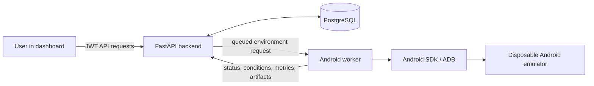

# PocketLab — The Cheap Phone Test

PocketLab tests Android application reliability under constrained device and network conditions. This repository contains the FastAPI backend and React dashboard.

## Repository layout

- `backend/` — FastAPI, SQLAlchemy, Alembic migrations, PostgreSQL configuration, and runner API.
- `frontend/` — React, TypeScript, Vite dashboard.

## Local development

Start the backend from `backend/`. Install the requirements and configure `backend/.env` first. PostgreSQL is the deployment database; see `backend/README.md` for PostgreSQL/Docker setup and migrations. SQLite is supported for local development only.

```powershell
cd backend
python -m venv .venv
.\.venv\Scripts\Activate.ps1
python -m pip install -r requirements.txt
Copy-Item .env.example .env
# Set database credentials and fresh JWT_SECRET and RUNNER_TOKEN values in .env.
alembic upgrade head
python -m scripts.seed
python -m uvicorn app.main:app --reload --host 127.0.0.1 --port 8000
```

Then start the dashboard from `frontend/` in another terminal:

```powershell
cd frontend
npm install
Copy-Item .env.example .env
npm run dev -- --host 127.0.0.1 --port 5173
```

- Dashboard: <http://127.0.0.1:5173>
- API docs: <http://127.0.0.1:8000/docs>

To execute APKs on real Android environments, start the execution worker on a machine with the Android SDK and
hardware acceleration (a third terminal for local development):

```powershell
cd backend
python -m app.workers.emulator_runner --capabilities   # what this host can really do
python -m app.workers.emulator_runner                  # claim and execute queued runs
```

To deploy publicly for free (dashboard and API on Vercel, PostgreSQL on Neon), see `backend/docs/DEPLOY_VERCEL.md`.
Live: dashboard https://pocketlab-wheat.vercel.app, API https://pocketlab-api.vercel.app/docs.

See `backend/docs/ANDROID_WORKER.md` for setup and `IMPLEMENTATION_REPORT.md` for what has and has not been verified.

Never commit `.env` files, credentials, local databases, APKs, or runner artifacts. See each application's README for tests, API contracts, and deployment limitations.

## Streamlit dashboard

`streamlit_app/streamlit_app.py` is a Streamlit version of the dashboard that uses the same API and accounts as the React app.
Run locally with `pip install -r streamlit_app/requirements.txt` and `streamlit run streamlit_app/streamlit_app.py`.
Deploy on https://share.streamlit.io: repository `kartikkumarbadgujar/pocketlab`, branch `main`, main file `streamlit_app/streamlit_app.py`.
Set the `POCKETLAB_API_URL` secret to use another API (default: https://pocketlab-api.vercel.app/api/v1).

## System design, database, and end-to-end run procedure

PocketLab has three parts: the React dashboard, the FastAPI backend, and an Android execution worker. The backend is the control plane: it authenticates users, stores projects and test requests, checks worker capabilities, and records progress and results. The worker is a separate process on a host with Android SDK tools; it creates and destroys the Android environment. The database stores the request and evidence metadata, not a running emulator.



### Database design

PostgreSQL is the deployment database. SQLAlchemy models describe the tables and Alembic migrations create or upgrade their schema. The API does not create production tables on startup. SQLite is used for isolated tests and single-process local development only; it is not suitable for concurrent production job claiming.

The main table groups are:

| Purpose | Tables and relationships |
|---|---|
| Accounts and ownership | `users` owns `projects` and registered `devices`; `refresh_tokens` stores hashed, rotating refresh credentials. |
| APK inventory | `app_builds` belongs to a project and records package/version metadata, SHA-256, private storage key, and scan status. Uploaded builds start quarantined. |
| Reusable test definitions | `condition_profiles` have immutable `condition_profile_versions`; `condition_profile_parameters` stores typed requested values. `measurement_definitions` describes supported measurement/configuration keys. `test_scenarios` have versioned `scenario_steps`. |
| Requested run | `test_runs` belongs to a project/user and links to an APK build. `run_profiles` and `run_scenarios` record the selected versions. `execution_environments` stores requested settings, preflight, lifecycle status, and effective configuration. |
| Worker coordination | `runner_agents` reports worker identity/capabilities; `runner_leases` records the worker holding a run and its expiry. A lease allows recovery and retry after worker loss. |
| Results and audit | `condition_applications` records requested/applied/observed conditions and evidence; `metric_samples`, `findings`, `evidence_artifacts`, `environment_events`, and `impact_estimates` store results. `audit_logs` records important user actions; `idempotency_records` prevents duplicate run creation on retries. |

Foreign keys, unique constraints, check constraints, and indexes enforce ownership links, version uniqueness, allowed states, measurement sample uniqueness, and common query patterns. Large APKs and evidence files are stored on disk or private object storage; PostgreSQL keeps their storage keys, hashes, sizes, and metadata. The worker verifies the APK hash again before installation.

### What happens when a user starts a test

1. The user signs in; the dashboard sends a short-lived JWT with authenticated API requests.
2. The user creates a project, uploads an APK, and chooses a profile, scenarios, and Android/network settings.
3. An operator reviews and approves the quarantined APK using `python -m scripts.approve_build <build_id> --reason "..."` from `backend/`. The user cannot approve their own build through the API.
4. The dashboard calls preflight. The backend checks the requested configuration against a recent worker capability report and, for a physical device, verifies the device is registered and available.
5. After confirmation, the API creates a `test_runs` row and an `execution_environments` row. It stores the settings and marks the environment `QUEUED`; the dashboard does not create an emulator directly.
6. The worker claims the queued run using `RUNNER_TOKEN` and a time-limited lease. For emulator runs it creates a fresh AVD, boots it, verifies the device, installs the approved APK, applies supported conditions, and runs selected scenarios. A physical-device run uses an explicitly mapped ADB device instead.
7. The worker reports lifecycle events, condition application records, measurements, findings, and artifacts through runner endpoints. The API persists these results and the dashboard polls them for live status.
8. The worker reverts temporary settings, stops and removes the emulator, reports cleanup, and completes or fails the run. If the worker disappears, the expired lease lets another attempt recover the run.

### Run the complete local setup (Windows / PowerShell)

#### 1. Configure and start the database and API

Use either a local PostgreSQL installation or Docker Compose. For Compose, from `backend/`, create `.env` from `.env.example`, set a strong `POSTGRES_PASSWORD`, `JWT_SECRET`, and `RUNNER_TOKEN`, then run:

```powershell
cd backend
Copy-Item .env.example .env
# Edit .env: use a strong POSTGRES_PASSWORD and independent random JWT_SECRET and RUNNER_TOKEN values.
docker compose up --build -d
docker compose exec api python -m scripts.seed
```

Compose starts PostgreSQL and the API; the API container applies Alembic migrations when it starts. The seed command loads the example profiles, scenarios, and measurement definitions. Check `http://127.0.0.1:8000/health/ready` for database readiness and `http://127.0.0.1:8000/docs` for the API. The API container is on the Compose network and exposes port 8000 to the host.

If you run the API directly on Windows instead, first run PostgreSQL locally and set `DATABASE_URL` in `backend/.env` to that host database. Then:

```powershell
cd backend
py -3.11 -m venv .venv
.\.venv\Scripts\Activate.ps1
python -m pip install -r requirements.txt
Copy-Item .env.example .env  # only if you have not made it already
alembic upgrade head
python -m scripts.seed
python -m uvicorn app.main:app --reload --host 127.0.0.1 --port 8000
```

Do not run both the Compose API and local API on port 8000 at the same time.

#### 2. Start the dashboard

In a second terminal, from the repo root:

```powershell
cd frontend
Copy-Item .env.example .env
npm install
npm run dev -- --host 127.0.0.1 --port 5173
```

Open `http://127.0.0.1:5173`. The frontend `.env` should set `VITE_API_BASE_URL=http://localhost:8000/api/v1` for this local API. Create an account and sign in.

#### 3. Prepare the Android worker

Install Android SDK platform tools, the emulator, Java 17, build tools, and at least one system image compatible with the worker host. Hardware acceleration must be enabled (WHPX on Windows, Hypervisor.framework on macOS, or KVM on Linux). In `backend/.env`, set `ANDROID_SDK_ROOT`, `POCKETLAB_WORK_DIR`, and `POCKETLAB_API_URL=http://127.0.0.1:8000/api/v1`; set `RUNNER_TOKEN` to exactly the same secret used by the API. Keep this file private.

From `backend/` with its Python environment active, check the worker and then start it:

```powershell
python -m app.workers.emulator_runner --capabilities
python -m app.workers.emulator_runner
```

Keep this terminal running while tests execute. The capabilities command should report the required SDK tools, system image, and virtualization as available. Follow [backend/docs/ANDROID_WORKER.md](backend/docs/ANDROID_WORKER.md) for SDK setup, physical-device mapping, and optional Linux network shaping.

#### 4. Upload, configure, and run an APK

1. In the dashboard, create a project and upload an APK you are authorized to test.
2. From `backend/`, approve the uploaded build as an operator: `python -m scripts.approve_build <build_id> --reason "Team-owned test APK"`.
3. Open Test Lab, select the project, approved APK, profile, and scenario versions. Set the requested emulator/network options.
4. Run environment preflight. Resolve blocking requirements, review unsupported or unverified settings, then confirm the configuration.
5. Start the run. The API records and queues the environment; the worker creates the disposable AVD and performs the test.
6. Follow run status and events in the live page. Review scenario outcomes, measurements, condition evidence, findings, artifacts, and cleanup status when complete.

For a hosted Vercel deployment, the API does not have Android SDK or hardware acceleration; run the worker on a separate machine. The Vercel function's `/tmp` storage is temporary and not shared between instances, so it is not suitable for APKs that a separate worker must download. Use a local/shared persistent-storage API or configure private object storage for end-to-end APK execution. See [backend/docs/DEPLOY_VERCEL.md](backend/docs/DEPLOY_VERCEL.md) for deployment limits.

### Migrations and maintenance

After updating the code, apply schema changes with `alembic upgrade head` from `backend/` against the configured database. Seed catalog data with `python -m scripts.seed` when needed; seeding is idempotent. Never use `Base.metadata.create_all()` as a deployment migration strategy. Back up PostgreSQL and private file/object storage together so database metadata does not point to missing APKs or evidence.
