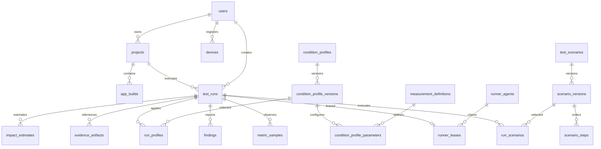

# PocketLab backend

FastAPI and SQLAlchemy backend for reproducible constrained Android application tests. PostgreSQL is the deployment database. SQLite is available for local tests and single-process development; its locking behavior is not suitable for production job claiming.

## Local setup

Python 3.11 or later is required. From this directory:

```powershell
py -3.11 -m venv .venv
.\.venv\Scripts\Activate.ps1
python -m pip install -r requirements.txt
Copy-Item .env.example .env
```

Edit `.env` and replace both `JWT_SECRET` and `RUNNER_TOKEN` with independent random values of at least 32 characters. For example, generate one with `python -c "import secrets; print(secrets.token_urlsafe(48))"`. Keep `.env` private.

For PostgreSQL, start a local server and set `DATABASE_URL` in `.env`. To run with Docker Compose instead:

```powershell
docker compose up --build -d
docker compose exec api python -m scripts.seed
```

The compose file exposes PostgreSQL only to the compose network and persists its database and private upload volume. It uses development credentials; replace them before deploying beyond a local machine.

Apply schema migrations, seed the illustrative catalog, and start the API:

```powershell
alembic upgrade head
python -m scripts.seed
uvicorn app.main:app --reload
```

Interactive API docs are at `http://127.0.0.1:8000/docs`; liveness and database readiness are `/health/live` and `/health/ready`. Migrations are the only production schema mechanism; the API does not call `create_all()` at startup.

## Tests

```powershell
pytest -q
```

The suite uses an isolated in-memory SQLite database, covers authentication and refresh rotation, access control, SQL-injection-shaped input, validation, idempotent runs, duplicate metric samples, retry/lease recovery, APK archive rejection, impact estimation, and failed-write behavior. It does not exercise concurrent PostgreSQL claims or an Android device. Use PostgreSQL integration and disposable runner testing before deployment.

## Runner protocol

All `/api/v1/runner/*` endpoints require `Authorization: Bearer $RUNNER_TOKEN`, separate from user JWTs. Register/heartbeat an agent, claim work, and heartbeat the lease while the isolated Android runner executes. Leases last 90 seconds; an expired or failed job is retried up to three attempts and then failed. PostgreSQL uses `FOR UPDATE SKIP LOCKED`; SQLite ignores those locking semantics and only supports local single-worker development.

Runner identity fields identify the agent within the shared runner credential boundary; production should issue per-agent credentials and rotate/revoke them. The backend does not expose ADB shell commands or execute APKs. The runner must execute app builds in a disposable isolated Android environment. The included reaper function can be called by a scheduler; claim also recovers expired leases so a separate scheduler is not required for MVP progress.

## Data integrity and measurement semantics

Profile-version `configuration_json` and `condition_profile_parameters` describe **requested conditions**. `metric_samples` store **observed values**, including source, UTC timestamp, unit, device/run association, validity and metadata. Configured packet loss does not become a measured packet loss sample. `unsupported` and `unavailable` samples must omit a value and can carry a reason in metadata. Android thermal status uses the Android 0–6 enum; thermal headroom and battery temperature remain separate metrics. No IMEI, phone number or permanent hardware ID is part of the device model.

The seeded profiles are illustrative test configurations, not national device distribution data. They do not assert that a target RAM or storage limit was applied; actual-device runs require a registered device, and the runner must verify conditions and report observations.

Impact estimates use `MAU × population share × observed failure rate`, report a 95% Wilson interval for the measured failure rate, require callers to mark condition groups mutually exclusive, and reject cumulative shares above 100%. `is_synthetic` distinguishes demo estimates from real user data. Caller-provided data sources and assumptions are retained.

APK uploads are size-limited, hashed, required to be ZIP archives with an Android manifest entry, and written under a private quarantine storage key. A build remains quarantined and cannot be queued until an external scanner has approved it; scanner integration and approval workflow are deployment work. They are not executed by FastAPI. The MVP checks archive structure and manifest presence; it does not replace a production malware scanner, full Android binary manifest parser/package-signature verification, private object-storage policy, or disposable runner controls.

## API overview

All application routes are under `/api/v1`. User routes use short-lived JWT access tokens and rotating opaque refresh tokens. Project resources are filtered through owner authorization. Send `Idempotency-Key` on `POST /test-runs` to safely retry run creation.

| Area | Routes |
|---|---|
| Auth | `POST /auth/register`, `/auth/login`, `/auth/refresh`, `/auth/logout` |
| Projects | `GET/POST /projects`, `GET/PUT/DELETE /projects/{id}` |
| Devices | `GET /devices`, `POST /devices/register`, `GET /devices/{id}` |
| Profiles | `GET/POST /profiles`, `GET /profiles/{id}`, `POST /profiles/{id}/versions` |
| Scenarios | `GET /scenarios`, `GET /scenarios/{id}` |
| Builds | `POST/GET /projects/{id}/builds` (upload uses multipart `file`, `package_name`) |
| Runs | `POST/GET /test-runs`, `GET /test-runs/{id}`, `POST /test-runs/{id}/cancel`, `GET .../metrics`, `/findings`, `/artifacts`, `POST .../impact-estimates` |
| Runner | `POST /runner/heartbeat`, `/runner/jobs/claim`, `/runner/jobs/{id}/heartbeat`, `/complete`, `/fail`, `/metrics/batch`, `/findings` |

FastAPI publishes request/response schemas via `/docs` and `/openapi.json`. Runner metrics batch accepts `agent_name`, `authentication_identity`, and `samples`; metric `sample_key` is unique per run, making replayed batches safe.

## Architecture



Large APKs and evidence files are referenced by private storage keys; PostgreSQL retains hashes, sizes, types and metadata only. `metric_samples` has a unique `(test_run_id, sample_key)` constraint. Runs and refresh credentials have separate idempotency/revocation records. Foreign keys, cascade behavior, range checks, unique constraints and run/owner/time indexes are defined in the ORM and Alembic initial migration.

## Deployment notes

This is an MVP backend scaffold, not a production-ready hosted test service. Before handling real users or APKs, configure managed PostgreSQL with backups/TLS, private object storage with lifecycle policies, per-runner credentials, shared rate limiting for multi-worker deployments, secret management and rotation, stronger APK analysis, audit retention, observability, and a hardened disposable Android runner. Test PostgreSQL claim races, lease recovery during process restarts, upload limits at the reverse proxy, and perform security review and penetration testing.
