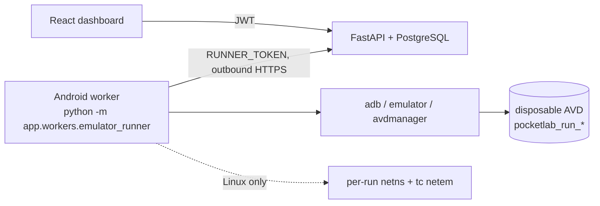

# PocketLab Android execution worker

The worker is the only component that touches Android tooling. It runs **outside** the FastAPI process, connects
**outward** to the API with `RUNNER_TOKEN`, claims queued runs, and for each run creates a disposable AVD, boots it,
verifies the actual device, installs the approved APK, applies and verifies conditions, executes the scenarios,
uploads measurements, findings, screenshots and logs, and then destroys everything it created.



The API never runs `adb`, the emulator, or an APK. Long-running work is never done inside an HTTP request: the
dashboard's `prepare`/`execute`/`cancel` calls return `202` and the worker does the work.

## 1. Host requirements

| Host | Acceleration | Notes |
|---|---|---|
| Windows 10/11 x64 | Windows Hypervisor Platform (WHPX) or the Android Emulator hypervisor driver | Enable *Windows Hypervisor Platform* in "Turn Windows features on or off" and reboot. Packet-level shaping is **not available** (needs Linux). |
| macOS (Apple silicon / Intel) | Hypervisor.framework (built in) | Apple silicon needs `arm64-v8a` images; Intel needs `x86_64`. No packet-level shaping. |
| Linux x86_64 | KVM (`/dev/kvm` readable/writable by the worker user) | Required for the netem gateway (packet loss, jitter distribution, DNS failure). Use a **dedicated** VM or host. |

Minimum for one 2 GB emulator: 4 free host RAM GB (guest + ~1.5 GB emulator overhead), 2 logical CPUs, 8 GB free disk
in the work directory. API 37 and newer requires a 4 GB guest and a 6 GB data filesystem, so reserve at least 5.5 GB
host RAM and 8 GB free disk for those images. The worker refuses to start an emulator if the host cannot reserve this.

## 2. Install the Android SDK pieces

Install Android Studio **or** the command-line tools (Java 17 is needed by `sdkmanager`/`avdmanager`; if
`avdmanager` cannot run, the worker writes the AVD config files directly and records that it did).

```powershell
# Windows example; adjust the SDK path. The worker never guesses it.
$env:ANDROID_SDK_ROOT = "$env:LOCALAPPDATA\Android\Sdk"
& "$env:ANDROID_SDK_ROOT\cmdline-tools\latest\bin\sdkmanager.bat" `
  "platform-tools" "emulator" "build-tools;34.0.0" "system-images;android-30;google_apis;x86_64"
```

Use a **`google_apis`** (not `google_apis_playstore`) image: memory-pressure tests need `adb root`, which Play Store
images refuse. `build-tools` provides `aapt2`/`apksigner` (optional; a built-in manifest parser is used otherwise).

## 3. Configure and verify the worker

Add to `backend/.env` (the worker loads it; real environment variables win):

```ini
POCKETLAB_API_URL=http://127.0.0.1:8000/api/v1
RUNNER_TOKEN=<the same value the API uses>
ANDROID_SDK_ROOT=C:\Users\you\AppData\Local\Android\Sdk
POCKETLAB_WORK_DIR=./worker_data
```

Check what this host can really do (every status comes from an actual check):

```powershell
cd backend
.\.venv\Scripts\python.exe -m app.workers.emulator_runner --capabilities
```

`emulator`, `adb`, `virtualization` must be `available` and at least one image must be listed. `avdmanager` is optional;
the worker writes a validated, run-scoped AVD config when that tool is missing. API 37+ phone images need at least
4 GB RAM and 6 GB for `/data`; the dashboard fills those minimums from the installed worker image list. Anything shown as
`requires_linux_gateway` or `requires_physical_device` will be reported as *not applied* in runs.

## 4. End-to-end run (hackathon flow)

1. Start PostgreSQL, then the API: `alembic upgrade head`, `python -m scripts.seed`, `uvicorn app.main:app`.
2. Start the dashboard: `cd frontend; npm install; npm run dev`.
3. Start the worker in another terminal: `python -m app.workers.emulator_runner`.
4. In the dashboard create a project and upload **your own team's** APK (or an authorized sample).
5. Approve it as the operator (there is intentionally no HTTP endpoint for this):
   `python -m scripts.approve_build <build_id> --reason "Team-owned demo build"`
6. Test Lab → *Android emulator (real AVD)* → pick `ENTRY_LEVEL_CONSTRAINED` (2 GB RAM, 400 MB free storage,
   180 ms latency, 20% battery, battery saver) → select scenarios → **Run environment preflight** → read the
   "Will NOT be applied" box → confirm → **Start real Android test**.
7. The live page shows each lifecycle stage only after the worker reports it, requested vs applied vs observed
   values, scenario outcomes, screenshots, logs, findings and cleanup status.

App-specific checks (cart, product image, API result) need **UI bindings** (resource id or text of the element). Without
a binding those scenarios end as `blocked`, never as `passed`.

## 5. Lifecycle, isolation and cleanup

`QUEUED → PREFLIGHT → PROVISIONING → BOOTING → READY → INSTALLING → APPLYING_CONDITIONS → VERIFYING_CONDITIONS →
EXECUTING → COLLECTING_METRICS → ANALYZING → COMPLETED → CLEANING → CLEANED` (or `FAILED`/`CANCEL_REQUESTED` → `CLEANING`
→ `CLEANED`). The API rejects invalid transitions.

* One emulator job per host (file lock). Unique AVD name and console/adb port pair per run attempt.
* AVDs live in `POCKETLAB_WORK_DIR/avd` (a dedicated `ANDROID_AVD_HOME`); Android Studio AVDs are never listed,
  modified or deleted. Every attempt gets a new AVD and boots without snapshots. Its new userdata image is already
  clean, so the worker skips the redundant `-wipe-data` copy before boot.
* Cleanup always runs: storage fill removed and verified, memory workload unmounted, battery saver reset, shaping
  removed, emulator stopped (console `kill`, then process termination), AVD and run directory deleted.
* Abandoned work: a lease that stops heart-beating expires after 90 s and the run is retried (max 3 attempts). A
  restarted worker sweeps orphaned `pocketlab_run_*` emulators/AVDs it recorded (`--sweep` does it on demand).
* Cancel from the dashboard sets `CANCEL_REQUESTED`; the worker stops at the next step, cleans up, then confirms.

## 6. Linux netem gateway (packet loss, jitter distribution, burst loss, duplication, reordering, DNS failure)

Only on a **dedicated Linux worker VM**. The emulator and its own adb server run inside a per-run network namespace
`pl<run>`; `tc netem` is applied to that namespace's veth pair, so the host's interfaces are never shaped.

One-time host preparation (as root, on the worker VM only):

```bash
sysctl -w net.ipv4.ip_forward=1
iptables -t nat -A POSTROUTING -s 10.213.0.0/16 -o <egress-interface> -j MASQUERADE
# Egress allowlist for test traffic (example: only your test API and the probe host)
iptables -A FORWARD -s 10.213.0.0/16 -d <your-test-api-ip> -j ACCEPT
iptables -A FORWARD -s 10.213.0.0/16 -d 1.1.1.1 -j ACCEPT
iptables -A FORWARD -s 10.213.0.0/16 -j DROP
```

The worker calls `sudo -n ip ...`, `sudo -n tc ...` and launches the emulator through
`sudo -n ip netns exec pl<run> sudo -n -u <worker-user> emulator ...`. **Security note:** a sudo rule that permits
`ip netns exec` is effectively root on that machine. That is acceptable only on a disposable, single-purpose VM. The
hardening step before any shared deployment is a root-owned wrapper that validates the namespace name and allows
only these fixed operations. Enable with `POCKETLAB_NETEM_ENABLED=1`; `--capabilities` then reports `network_gateway`
as `supported` only if non-interactive sudo actually works.

> This backend is implemented and unit-tested at the command-construction level only; it has **not** been exercised
> on a real Linux host in this repository's verification (see `IMPLEMENTATION_REPORT.md`).

## 7. Physical devices

Register the phone in the dashboard (Devices), then map its id to the ADB serial on the worker only:
`POCKETLAB_PHYSICAL_DEVICES={"3": "R58M123ABC"}`. Authorize USB debugging. Physical runs observe real hardware,
thermal status, HAL temperatures and battery temperature (`ACTUAL`); hardware changes and network shaping are
reported as unsupported; battery state overrides use `dumpsys battery` and are reset afterwards; the app is
uninstalled after the run.

## 8. Security model

* Uploaded APKs are untrusted: quarantined until an operator approves them; SHA-256 re-verified by the worker;
  package name must match the build record.
* The emulator is not a complete security boundary. Run the worker as an unprivileged user on a dedicated VM/host
  with no access to API secrets, no Docker socket, restricted egress, and a dedicated disk.
* Subprocesses: argument arrays only, no shell, executable allowlist, PocketLab secrets stripped from child
  environments, all device-shell tokens quoted, emulator console commands restricted to a fixed grammar. No user
  input becomes a shell command; UI bindings are matched host-side against a UIAutomator dump.
* Worker credentials (`RUNNER_TOKEN`) are separate from user JWTs. Physical ADB serials never leave the worker.

## 9. Troubleshooting

| Symptom | Check |
|---|---|
| `virtualization unavailable` | `emulator -accel-check`; enable WHPX/KVM; nested virtualization in cloud VMs |
| Boot timeout | Increase `POCKETLAB_BOOT_TIMEOUT_S`; first boots of a new API image take longer; check `emulator.log` artifact |
| Memory pressure `requires_rootable_image` | Install a `google_apis` image for the selected API |
| Network RTT/loss `UNAVAILABLE` | The emulator's user-mode network often drops ICMP; this is reported, not estimated |
| Scenario `blocked` | Add the UI binding named in the reason, or request the condition the scenario needs |
| Orphaned emulator after a crash | `python -m app.workers.emulator_runner --sweep` |
